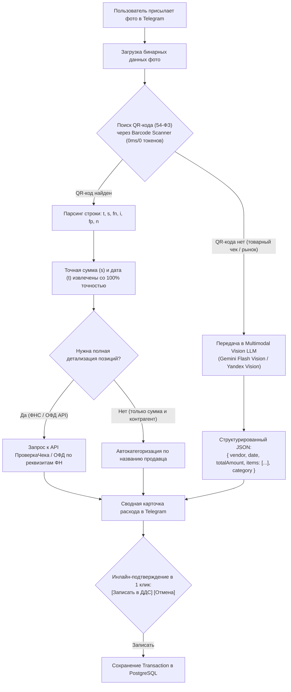

# 📐 Спецификация архитектуры: Telegram-бот и OCR-процессинг чеков (Фаза 6)

- **Проект:** FinRest (`finrest`)
- **Статус:** Черновик / Готов к согласованию
- **Дата:** 2026-11-08
- **Автор:** DeepMind Antigravity Agent
- **Версия:** 1.0.0

---

## 1. Введение и бизнес-цели

В ресторанном бизнесе (HoReCa) управляющие и владельцы заведений проводят 85–90% времени «в зале» или на кухне, а не за экраном десктопного компьютера. Ключевые операционные боли:
1. **Кассовые разрывы из-за забытых чеков:** наличные расходы на рынке (зелень, мясо, бытовая химия) шеф-повар или закупщик записывает на бумажках или забывает внести в учет до конца недели.
2. **Задержка управленческой отчетности:** владелец хочет видеть выручку и остаток налички в сейфе сразу после закрытия смены (в 23:30–00:00), а не ждать сводный отчет бухгалтера через 3 дня.
3. **Оперативное решение задвоений:** когда банк и iiko зафиксировали пересечение, быстрее подтвердить объединение в 1 клик на смартфоне, чем заходить в веб-интерфейс.

**Цель Фазы 6:** Развернуть омниканального Telegram-бота для FinRest, интегрированного в единое ядро PostgreSQL/Prisma, с поддержкой двухступенчатого OCR-распознавания кассовых/товарных чеков и мгновенных алертов.

---

## 2. Сравнительный анализ стека и архитектурные решения

### 2.1. Telegram Bot Framework: grammY vs Telegraf

| Критерий | `grammY` (Рекомендуемый выбор) | `Telegraf` |
| :--- | :--- | :--- |
| **Поддержка TypeScript** | Нативная, строгая типизация контекста (`Context`, `SessionFlavor`) | Историческая, типы периодически отстают от Telegram Bot API |
| **Next.js App Router** | Официальный встроенный адаптер `'std/http'` под Web Request/Response | Требует хаков с преобразованием Node.js streams в Next.js Route Handlers |
| **Плагины диалогов** | `@grammyjs/conversations` (асинхронные генераторы без спагетти в БД) | Сцены (`Scenes`) с громоздким бойлерплейтом |
| **Производительность** | Высокая пропускная способность, нулевые внешние зависимости ядра | Заметно тяжелее |

**Решение:** Использовать **`grammY`** с модулем `@grammyjs/conversations` и валидацией через `Zod`.

---

### 2.2. Архитектура доставки: Webhook vs Long Polling

1. **Production (Docker Compose & Vercel):**
   - Единый эндпоинт Next.js Route Handler: `POST /api/telegram`.
   - Валидация заголовка `X-Telegram-Bot-Api-Secret-Token` (предотвращает подделку запросов).
   - Обработка в реальном времени с немедленным возвратом `200 OK` в Telegram API, чтобы исключить повторные ретраи при длительном OCR-анализе.

2. **Development / Local Sandbox:**
   - Отдельный CLI-скрипт `scripts/bot-polling.ts`, запускающий `bot.start()` через Long Polling без необходимости проброса ngrok / внешнего домена.

```
       [ Telegram Messenger ]
                 │ (HTTPS POST Webhook)
                 ▼
     [ Nginx Reverse Proxy ]
                 │
                 ▼
 [ Next.js App Router: POST /api/telegram ]
                 │
      ┌──────────┴──────────┐
      ▼                     ▼
[ grammY Dispatcher ]   [ Secret Token Guard ]
      │
      ├──> Command: /start (Deep-link Auth)
      ├──> Message: Text Expense (NLP Auto-Categorizer)
      ├──> Message: Photo (2-Stage OCR Pipeline)
      └──> CallbackQuery: Deduplication Resolution
```

---

## 3. Двухступенчатый OCR-пайплайн для ресторанных чеков

В российских реалиях HoReCa заведения сталкиваются с двумя принципиально разными типами платежных документов:
1. **Фискальные чеки (54-ФЗ):** чеки из сетевых магазинов (METRO, ВкусВилл, гипермаркеты) содержат стандартный QR-код.
2. **Товарные чеки и накладные с рынков:** закупка свежей зелени, овощей и мяса на оптовых продовольственных рынках (Даниловский, Фуд Сити). Это рукописные или отпечатанные на ленте документы без 54-ФЗ QR-кода.

### Схема гибридного конвейера:



### 3.1. Этап 1: Распознавание QR-кода 54-ФЗ
Формат строки в QR-коде:
`t=20261108T143000&s=12450.50&fn=9282440300829880&i=10556&fp=189504453&n=1`

* **`t`**: Дата и время операции (`2026-11-08T14:30:00`).
* **`s`**: Сумма в рублях (`12450.50`).
* **`fn`**, **`i`**, **`fp`**: Фискальные реквизиты документа.
* **Преимущество:** Срабатывает мгновенно (< 80мс), нулевая стоимость токенов, абсолютная математическая точность суммы (исключает ошибки галлюцинаций LLM при нечетком шрифте кассовой термоленты).

### 3.2. Этап 2: Multimodal LLM Vision (Рыночные накладные и товарные чеки)
Если QR-код не найден или документ является рукописной квитанцией, изображение отправляется в мультимодальную модель со схемой ответа (Structured Output / JSON Schema):

```json
{
  "vendor": "ИП Мамедов А.Г. (Даниловский рынок)",
  "date": "2026-11-08",
  "totalAmount": 15400.00,
  "currency": "RUB",
  "items": [
    { "name": "Томаты Баку", "quantity": 20, "unit": "кг", "price": 450, "total": 9000 },
    { "name": "Кинза и базилик", "quantity": 10, "unit": "кг", "price": 640, "total": 6400 }
  ],
  "suggestedCategory": "food",
  "confidence": 0.94
}
```

---

## 4. Схема данных в PostgreSQL (Prisma)

Для обеспечения безопасности и Multi-tenancy добавляются новые модели в `prisma/schema.prisma`:

```prisma
// Связь Telegram-аккаунта с пользователем FinRest
model TelegramAccount {
  id              String         @id @default(uuid())
  telegramId      BigInt         @unique // Telegram Chat ID / User ID
  username        String?
  firstName       String?
  lastName        String?
  userId          String
  user            User           @relation(fields: [userId], references: [id], onDelete: Cascade)
  activeVenueId   String?        // Текущее выбранное заведение для ввода расходов
  venue           Venue?         @relation(fields: [activeVenueId], references: [id], onDelete: SetNull)
  createdAt       DateTime       @default(now())
  updatedAt       DateTime       @updatedAt

  receiptScans    ReceiptScan[]
  sessions        TelegramSession[]

  @@index([telegramId])
  @@index([userId])
}

// Сессии для FSM / Conversations в боте
model TelegramSession {
  id              String           @id @default(uuid())
  telegramAccountId String
  account         TelegramAccount  @relation(fields: [telegramAccountId], references: [id], onDelete: Cascade)
  key             String
  value           Json
  expiresAt       DateTime?

  @@unique([telegramAccountId, key])
}

// Логирование и аудит распознанных чеков
model ReceiptScan {
  id                String           @id @default(uuid())
  telegramAccountId String
  account           TelegramAccount  @relation(fields: [telegramAccountId], references: [id], onDelete: Cascade)
  venueId           String
  venue             Venue            @relation(fields: [venueId], references: [id], onDelete: Cascade)
  
  sourceType        String           // "qr_54fz" | "vision_llm" | "manual_text"
  rawText           String?          @db.Text
  extractedAmount   Float
  extractedDate     DateTime
  extractedVendor   String?
  category          String           // "food" | "bar" | "household" | etc.
  confidence        Float            @default(1.0)
  
  status            String           // "pending" | "confirmed" | "rejected"
  transactionId     String?          @unique
  transaction       Transaction?     @relation(fields: [transactionId], references: [id], onDelete: SetNull)
  
  createdAt         DateTime         @default(now())

  @@index([venueId, createdAt])
}
```

---

## 5. Ключевые пользовательские сценарии (UX)

### Сценарий 1: Авторизация через Deep-Link или 6-значный PIN
1. Пользователь заходит в FinRest: **Настройки → Интеграция с Telegram**.
2. Нажимает кнопку **«Подключить Telegram»**:
   - Вариант А: Прямая ссылка `https://t.me/FinRestBot?start=auth_9a8b7c6d5e`.
   - Вариант Б: Одноразовый 6-значный код (например, `482-195`), действующий 10 минут.
3. Бот приветствует пользователя, определяет его роль (`OWNER`, `MANAGER`) и список доступных ресторанов.

### Сценарий 2: Вечерний Flash-отчет в 23:30 (Cron / Scheduled Event)
Ежедневно в 23:30 бот формирует лаконичную финансовую сводку за день:
```text
📊 Flash-отчет: Ресторан «Панорама» (08.11.2026)

💰 Выручка за день: 248 500 ₽ (нал: 42 000 ₽ / безнал: 206 500 ₽)
📉 Расходы за смену: 64 200 ₽
   • Продукты (Food): 41 000 ₽
   • Хоз. нужды: 8 200 ₽
   • ФОТ (выплаты смены): 15 000 ₽

💵 Сейф ресторана:
   • По данным iiko (остаток): 184 200 ₽
   • Внесено/изъято за день: +27 000 ₽
   ⚠️ Внимание: расхождение с кассовой сменой: -1 200 ₽

📈 Чистая операционная маржа смены: 74.2% (+184 300 ₽)
```

### Сценарий 3: Алерты дедупликации с инлайн-действиями
Когда ночной или ручной импорт находит подозрительное задвоение между кассой iiko и банковским эквайрингом:
```text
⚠️ Обнаружен дубликат расхода (Сходство: 92%)

1️⃣ Касса iiko: 12 000 ₽ (08.11 14:20) — «ООО Восток Мясо»
2️⃣ Выписка банка: 12 000 ₽ (09.11 11:00) — «ООО Восток»

[✅ Объединить (скрыть дубль)]    [❌ Это разные платежи]
```
При нажатии на кнопку транзакция помечается в БД без перезагрузки и диалог обновляется на:
`✅ Расходы успешно объединены в отчете ОПиУ и ДДС.`

### Сценарий 4: Быстрый ввод расхода (Текст или Фото)
* **Текст:** Шеф-повар пишет в чат: *"14500 зелень и овощи Фудсити нал"*.
* **Ответ бота:**
```text
🧾 Распознан расход наличными:
• Сумма: 14 500 ₽
• Контрагент: Фудсити
• Статья: Продукты питания (Food Cost)
• Источник: Сейф / Наличные

[✅ Подтвердить]   [✏️ Изменить]   [❌ Отмена]
```

---

## 6. Безопасность и 152-ФЗ

1. **Токены и авторизация:**
   - Секретный токен вебхука `TELEGRAM_WEBHOOK_SECRET` проверяется в заголовке каждого входящего запроса.
   - Никакие финансовые отчеты не отправляются в открытые группы — только в личные верифицированные диалоги.
2. **Локализация данных (152-ФЗ):**
   - Все персональные данные пользователей, токены чатов и финансовые транзакции хранятся исключительно в локальной базе PostgreSQL на российских серверах.
   - Фотографии чеков временно обрабатываются в оперативной памяти и не сохраняются на сторонних незащищенных серверах.

---

## 7. План внедрения (Roadmap Phase 6)

1. **Шаг 1:** Установка зависимостей (`grammy`, `@grammyjs/conversations`, `jsqr`) и добавление миграции Prisma для `TelegramAccount` и `ReceiptScan`.
2. **Шаг 2:** Создание Next.js Route Handler `src/app/api/telegram/route.ts` и сервиса авторизации deep-link.
3. **Шаг 3:** Реализация парсера QR-кодов (54-ФЗ) и коннектора Gemini/Yandex Vision.
4. **Шаг 4:** Реализация интерактивных сценариев (Flash-отчет, инлайн-дедупликация, карточка расхода).
5. **Шаг 5:** Интеграционные тесты сценариев бота и нагрузочное тестирование вебхука.
